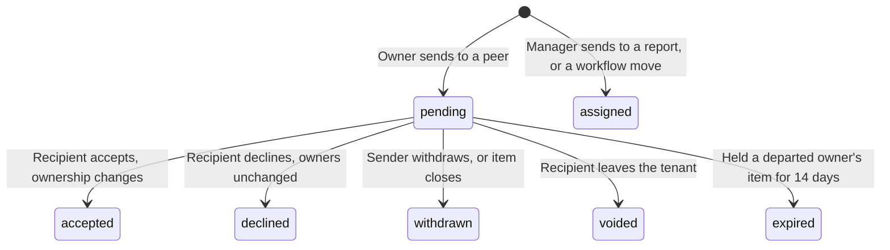
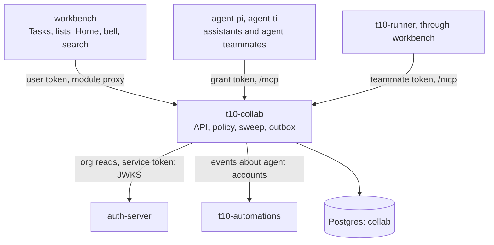

# Team Collaboration Design

Oct 31, 2026 · @Felix Liang · Rewritten Nov 14, 2026 to describe what's built

Status: built and in use. Workbench is its client (Tasks, Shared lists, the task page, Home, the bell and search), agent teammates work through `/mcp`, and lists can carry workflows. [`workflows.md`](workflows.md) covers workflows, the README lists where the build differs from the first design, and [History](#history) keeps how it got here.

## Summary

`t10-collab` is the business module where the people and agent teammates of a tenant send work to each other and manage it together. It's a small Go service with its own Postgres database, and it trusts `auth-server` for identity and org facts only.

Six decisions keep it small:

1. **People's work, not agent tasks.** A work item lasts until someone finishes it; an agent's background task lives and dies with its conversation. They share no table, ID, queue or tool name. See [Not the agent task](#not-the-agent-task).
2. **Nobody gets work without agreeing, except down the reporting line.** Between peers, a send is an offer that the recipient accepts or declines. A manager's send to someone beneath them is an assignment. A list workflow moves items without asking only to holders who agreed: list owners, plain members who agreed to hold stages, and agents whose admin opened them to the list.
3. **Many owners, many collaborators.** An item can have several owners with the same rights, and others who work on it or follow it.
4. **Shared lists are how a group works together.** A list has its own members, because an org unit can't model a cross-team group. It can link to an org unit to fill those members, and carry a workflow, a route for its items.
5. **Agent teammates are members like people.** A tenant agent account can own, collaborate, sit on lists and hold stages, under the same access rules, plus limits that keep agents from looping.
6. **One policy package.** Every route and agent tool uses the same access check, applied in the SQL query before pagination.

## Terms

Users see "task". Code, schema, API routes and tool names say **work item**, so a search for `task` in t10 code only finds agent work.

| Term | Meaning |
| --- | --- |
| Work item | One piece of work. Shown to users as a task |
| Member | A person or an agent account in the tenant. "A person" in the access rules reads as a member |
| Owner | A member responsible for an item. An item can have several, all with the same rights |
| Collaborator | A member working on or following an item. Someone who hands an item on stays as one |
| Offer | A request for someone to take over or share ownership of an item |
| Assignment | A send that needs no acceptance: a manager's to someone beneath them, or a workflow move |
| Suggestion | A send an assistant drafted, for an owner to make with one click |
| Inbox | The offers waiting for a member's answer |
| Shared list | A named group of items and the members who manage them |
| Workflow | A list's route for its items: stages, each with holders. See [`workflows.md`](workflows.md) |
| Agent teammate | A tenant agent account, an ID starting `acc_`, working on items through `/mcp` |
| Intake | Who may send an agent teammate work: everyone, org units, or lists |

## Not the agent task

| | Agent task (`agent-pi`, `agent-ti`) | Work item (`t10-collab`) |
| --- | --- | --- |
| Who does the work | A sub-agent in a conversation | A member, person or agent teammate |
| Lifetime | Ends with its conversation | Lasts until someone finishes it, often days or weeks |
| Stored in | The conversation | Postgres, schema `collab` |
| Visible to | The parent conversation | The members on the item, and its list's members |
| Identifier | `t1`, unique per session | `wi_<hex>`, unique everywhere |
| Tools | `task_send`, `task_list`, `task_stop`, `task_note` | `work_*` |

- `t10-collab` never calls an agent harness, and no harness reads this database.
- Nothing here stores a task, session or conversation ID. A conversation that came from an item says so in its own metadata, and Workbench draws the chip.
- An assistant acting for a person is an ordinary caller with a delegated token: it reads and drafts, and only the person sends. An agent teammate acts as itself, through tools only it may use. Finishing an agent task never changes a work item by itself.

## Goals and non-goals

**Goals**

- Let a member send an item to another member, who accepts or declines it; let a manager assign one to someone beneath them.
- Show each member what they've received, sent, own and follow, and what's up for grabs on their lists.
- Let a group manage items together, with shared status, comments, links and history, and a route through stages.
- Let agent teammates take part with their own rights, without looping and without anyone getting their work unasked.
- Keep every action attributable to a member, and to the agent grant if one acted for them.
- Keep tenants isolated by database constraints as well as code.

**Non-goals**

- Sprints, boards, subtasks, dependencies, recurring items, labels and time tracking.
- File attachments: documents belong to `t10-knowledge`. An item holds **links** instead, up to 20 `https` URLs with a title and a kind (`pull_request`, `commit`, `build`, `document`, `other`), taken from the URL when left out. Nothing fetches them.
- Chat: comments belong to one item.
- Push notifications, email and SMS: notifications are stored apart from delivery, so a channel can be added later.
- Work shared across tenants.
- A domain's own work, such as a property work order. That stays in its app, under its rules; see [Place in one system](#place-in-one-system).

## User flows

**Send and receive.** Ada creates an item and owns it. She sends it to Bob with an optional note; it appears in his inbox and she still owns it. Bob accepts and takes her place as an owner, and Ada stays as a collaborator; or he declines with a reason and Ada keeps it. Ada can withdraw while it's pending. An item can have several pending offers, but one per recipient, and one pending transfer per sender.

**Share ownership.** A send with `mode=share` makes the recipient an owner beside the sender. Any owner can stop owning as long as another owner remains, or the item is on a list.

**Assign.** When the recipient is anywhere beneath the sender in the org, the send is an assignment: the recipient owns it at once. The service decides, not the client. With `transfer` the sender stays as a collaborator, with `share` as an owner.

**Suggest.** An assistant can't send, so it suggests: `suggest_to` on `work_create`, or `work_suggest` on an item the person owns. A suggestion gets the same org checks as a send, only owners see it, and the person sends it with one click from the task or Home.

**Manage together.** Any owner adds collaborators, who can edit and comment. Every member of a list can see and edit its items. A list item can have no owner, and any member can claim it, which gives a team a shared backlog. An owner can put an item made elsewhere, such as from a conversation, on a list they're on, or take it off.

**Route through a workflow.** A list owner sets stages such as Build, Review, Test and Approve. Each stage's holder passes the item on or sends it back with what to fix, and collab hands it to the next holder. See [`workflows.md`](workflows.md).

**Status.** `todo`, `doing`, `done` or `cancelled`. Anyone who can edit an item moves it between the first three, including reopening. Only the creator or an owner cancels. Closing an item withdraws its pending offers, and a closed item can't be sent.

## Architecture

| Concern | Decision |
| --- | --- |
| Runtime | One static Go binary, `:8082` (`18040` on the local cluster), two stateless replicas on Kubernetes, one on Compose |
| Database | Its own Postgres database and `collab` schema. Migrations are embedded and run at startup under an advisory lock |
| Messaging | No broker. Events for automations leave from an outbox table, posted at least once |
| Telemetry | OpenTelemetry, continuing an incoming `traceparent`. Spans hold no item text |

| Package | Owns |
| --- | --- |
| `workitems` | Items, status, owners, collaborators, comments, links, which list an item is on |
| `offers` | Sending, accepting, declining, withdrawing, suggestions, workflow moves |
| `lists` | Shared lists, members, unit links, workflows and who holds stages |
| `policy` | Every access rule, tenant settings, and the SQL filter for "items this caller can see" |
| `activity` | History, notifications, mentions, and writing the outbox |
| `events` | Posting the outbox to `t10-automations`, at least once, with backoff |
| `people` | Cached org reads from `auth-server` |
| `sweep` | The 15-minute job: departures and team-linked list members |
| `server` | HTTP routes with their required action, and the MCP tools |

### Who the caller is

The tenant always comes from the token's `tid`. A token with no `tid`, such as a platform admin's, is refused: platform admins get no path into these records.

| Token | Result |
| --- | --- |
| A person's | Routes, checked by `policy` |
| A delegated grant's (an assistant for a person) | Only `/mcp`, needing the tool's `work:*` action on the token and every grant, then checked as the person. Read and draft only |
| An agent teammate's | Only `/mcp`, as the agent account, with the agent-only tools too |
| A service's own | Refused on member routes |

The caller's own membership is trusted from the token, which is at most 5 minutes old. An action that names another member, such as a send or adding a collaborator, checks that member with `auth-server` and fails closed. So people keep reading and editing through a short auth outage, while sending stops.

## Access rules

These live only in `policy`. List reads apply them in SQL before pagination and counts. A missing item and a forbidden one both answer `404`.

| Action | Allowed for |
| --- | --- |
| Read, comment | Creator, owners, collaborators, the recipient of a pending offer, members of the item's list |
| Read only | Any owner's manager, if the tenant's manager visibility allows it |
| Edit fields, change status, add links | Creator, owners, collaborators, members of the item's list |
| Send | Any owner. For an unowned list item, any list member |
| Accept, decline | The offer's recipient |
| Withdraw | The offer's sender, or any owner |
| Stop being an owner | That owner, if another owner remains or the item is on a list |
| Claim | Any member of the item's list, if it has no owners |
| Put on a list, take off | An owner, onto a list they're on |
| Add or remove collaborators, cancel | Creator, any owner |
| Delete | Any owner; the creator too, for an unowned list item. A soft delete |
| Manage list members, rename, archive, link a unit, set the workflow | List owner |
| Start on a workflow, finish a stage | See [`workflows.md`](workflows.md) |
| Reassign a queued item, give a queued list an owner, tenant settings, agent intake | Module admin: a tenant admin, or a member whose business role grants `work:admin`, read from `auth-server` on each request |

- **Declining ends access.** A recipient not otherwise on the item can't see it after declining.
- **One owner can't remove another.** Adding an owner always goes through a send.
- **Only the reporting line skips acceptance.** A send is an assignment only when the recipient is beneath the sender, read fresh on each send, bypassing the cache. A workflow move assigns only to holders who agreed; see decision 2.
- **Units never decide the reporting line.** Only the manager chain does.
- **Module admins see only what needs them.** Tenant admins, and members whose business role grants `work:admin` (the "Task administrator" template), see the departure queue (titles and owners), tenant settings and agent intake. Collab reads `GET /v1/entitlements?module=collab` fresh on each admin request; a deployment whose catalog leaves collab out has tenant admins only. In Workbench the queue and settings are the Task admin page; agent intake stays on the teammate's page under Administration, which a tenant admin opens. Tenant admins control the org, so they can make themselves someone's manager; such changes are in auth's audit log.

### Manager visibility

Each tenant chooses whether managers can read their reports' items: `none` (the default), `direct_reports` or `all_reports`. It's read only, covers owned items only (never pending offers or items a report merely follows), is applied at request time and fails closed. Every member can read the setting, and each change is an event naming the admin. Turning it on exposes existing items, so Workbench warns the admin.

### Agent teammates

An agent account is told apart by its `acc_` ID. Its **intake** (`collab.agent_intake`, set by a module admin with `PUT /v1/admin/agents/{user}/intake`, `{everyone, units, lists}`) says who may send it work; with none, only its reporting line can. Each send to it checks intake, and so does each workflow move.

- **Agent-only tools.** `work_send`, `work_accept`, `work_decline`, `work_claim` and `work_advance` are refused unless the principal is an agent account, with a message to draft instead.
- **No loops.** An agent account sends at most 60 an hour and never to itself. The third agent-to-agent send with no person acting goes to the sending account's manager instead (`reason: agent_loop`). Workflow moves don't count: their rounds limit sends a loop to the lead.
- **Woken only when it's theirs.** Events about agent accounts (`work.offered`, `work.assigned`, `work.accepted`, `work.declined`, `work.commented`, `list.item_added`) leave from the outbox with the grant that caused them and a hop count, for `t10-automations` to fire on. An agent that has handed an item on is told of changes but not woken, unless a comment mentions it.
- **Names, not IDs.** An `@usr_…` or `@acc_…` in a comment that names an active member is stored as `@` and their display name.

**Where an item stands.** A single read says `pending_offers`, `working` (agent accounts expected to act that were told in the last 15 minutes and haven't), `mention` (the latest comment mentioning the caller), and with a workflow, its place on it.

## Data model

Foreign keys include `tenant_id`, so cross-tenant links are impossible. User IDs are plain text with no foreign key, since users live in `auth-server`. IDs are `prefix_<hex>`.

| Table | Holds |
| --- | --- |
| `work_items` | Title, description, status, priority, due date, creator, `list_id`, `stage`, `rounds`, `version`, `client_ref`, suggestion, soft delete, departure queue |
| `work_item_owners`, `work_item_collaborators` | Who owns and who works on an item. An item off a list always has an owner |
| `work_item_links` | Up to 20 links per item |
| `offers` | Sends: `transfer` or `share`, `pending`, `assigned`, `accepted`, `declined`, `withdrawn`, `voided`, `expired` |
| `lists`, `list_members` | Lists and their members: `owner` or `member`, `manual` or `org`, and `holds_at` for a plain member who agreed to hold stages |
| `list_workflows` | A list's workflow as one JSON document, with a version, rounds, lead and `auto_start` |
| `agent_intake` | Who may send each agent account work |
| `comments`, `events`, `notifications`, `outbox` | Comments; the append-only history and audit trail; one row per member to tell; events for automations |
| `tenant_settings` | Manager visibility |

**Writes.** A change, its event, its notifications and its outbox rows commit in one transaction. Each item has a `version`, and a stale write gets `409 version_conflict`. Accepting runs `UPDATE … WHERE state = 'pending'`, every change to an item's owners first locks its row, and a `client_ref` makes a retried create return the first item.

## API

Every route needs a bearer token and every list read is paginated. [`openapi.yaml`](openapi.yaml) is the full spec, and a test keeps it in step with the routes.

| Area | Routes |
| --- | --- |
| Items | `POST`, `GET /v1/work-items` (`view=owned`, `claimable`, `sent`, `collaborating`, `list`, `reports`; `q`, `status`, due range); `GET`, `PATCH`, `DELETE /v1/work-items/{id}`; `/events`; `/claim`; `/owners/me`; `/collaborators/{user}`; `/comments`; `/links`; `PUT /list`; `DELETE /suggestion` |
| Sending | `POST /v1/work-items/{id}/send`; `GET /v1/offers?box=inbox\|sent`; `POST /v1/offers/{id}/accept\|decline\|withdraw` |
| Lists | `GET`, `POST /v1/lists`; `GET`, `PATCH /v1/lists/{id}`; `PUT`, `DELETE /v1/lists/{id}/members/{user}`; `PUT`, `DELETE /v1/lists/{id}/holding` |
| Workflows | `PUT`, `DELETE /v1/lists/{id}/workflow`; `POST /v1/work-items/{id}/stage\|advance` |
| People | `GET /v1/people?q=&unit=`, `GET /v1/units` |
| Notifications | `GET /v1/notifications?after=`, `POST /v1/notifications/read` |
| Settings and admin | `GET /v1/settings`, `PUT /v1/admin/settings`; departures queue under `/v1/admin/departures`; `GET`, `PUT /v1/admin/agents/{user}/intake`; `GET /v1/admin/intake-lists` |
| Module | `GET /v1/module` (manifest), `GET /internal/v1/attention` (service token only) |
| Agents | `POST /mcp`: `work_list`, `work_get`, `work_comments`, `work_history`, `work_offers`, `work_lists`, `work_people`, `work_create`, `work_suggest`, `work_update`, `work_comment`, `work_link`, and for agent teammates only `work_send`, `work_advance`, `work_accept`, `work_decline`, `work_claim` |

Clients poll notifications about every 30 seconds. Polling needs no broker, and SSE can be added later without changing the data.

## When someone leaves

`auth-server` publishes no change events, so a job runs every 15 minutes under an advisory lock and reads every member of each tenant it holds work for. It decides everything from Postgres, so no row stays locked while it waits on the network, and it records nothing about who was handled: each pass works out what an item needs from its owners and offers as they stand.

| Event | Result |
| --- | --- |
| Membership `inactive` | Offers to them are voided and the sender told. They come off every list, and the list's workflow follows (see [`workflows.md`](workflows.md)). Their items move as below |
| Account suspended | New offers to them are refused. Items and list places stay. An item whose owners are all suspended joins the queue, and leaves it if one returns |
| Missing from a read, or the read fails | Nothing. Only an explicit `inactive` counts as leaving |

A departed owner comes off each open item if another owner remains or it's on a list. An item off a list keeps its last owner until someone takes it on, moving to the first that applies: a live offer, left in place for 14 days; the creator, offered it; each departed owner's manager in turn; the module admin's departure queue. These offers come from `system:sweep` as `share` with a 14-day expiry; a decline sends the item to the queue. Lists join the queue when no active owner remains, or no active member remains while they have open items.

## Team-linked lists

A list can link to one org unit; the link only fills `list_members`, and every check still reads that table. Only the unit's direct members join. Linking reads the unit at once and fails if it can't; the sweep keeps `org` members current and never touches `manual` ones, and every owner is `manual`. Removing an `org` member by hand is refused, since the sweep would add them back. A unit that returns `404` is cleared and its members become `manual`; a failed read changes nothing. Someone who leaves a unit can keep list access for up to 15 minutes.

## Place in one system

t10 is meant to work as one system: one frame, one sign-in, one bell and search across apps ([`workbench/docs/one-system.md`](../../workbench/docs/one-system.md)). Collab is a **capability module**: by the Nov 6 decision its screens compile into Workbench rather than being an app of their own, and it meets the module contract ([`contracts/module/README.md`](../../contracts/module/README.md)).

| Part of one system | How collab takes part |
| --- | --- |
| Rail | Workbench's sections Tasks and Shared lists, described in the same `nav` shape as an app's |
| Home | "Needs you" and "Waiting on others" rows from collab |
| Bell | Collab's notifications, each with a `target` (`collab:work_item:<id>`, `collab:list:<id>`) that opens the record's page from any module |
| Search | Task titles the person can see, through the module's `search`, which reads collab's `q` filter |
| Assistant | Agents read and draft through `/mcp`; "Send as task" turns a reply into an item; a conversation started from an item shows its chip |
| Agents on the team | Work items are how agents and people hand work to each other, as `ARCHITECTURE.md` plans |

**Work in a domain app stays there.** A property work order is assigned and tracked in Property, under its business roles; collab doesn't copy it. Collab is for work across teams and between people and agents. A task about a domain record links to its page.

**Not yet:**

- Record links that know the record: a link is a URL, so a task can't show a work order's current name or check who may see it.
- Tasks outside Workbench: Property's bell shows only Property's notifications, and the mobile app has no tasks.

## Security considerations

- **Tenant isolation:** `tid` from the verified token, backed by composite foreign keys.
- **Spam:** sending is rate limited per member; agents at most 60 sends an hour.
- **Untrusted text:** titles, descriptions, comments and notes are rendered as plain text. To an agent they arrive marked as data, so a colleague's task can't steer someone else's agent.
- **Agents:** an assistant can't send, accept or delete; an agent teammate acts only on what it owns or is offered, within its intake.
- **Sensitive content:** tokens, item text and comments are never logged.

## Open questions

- [ ] **Can one send go to several people?** One recipient today. An item can already have several pending `share` offers, so a later version could send one to each.
- [ ] **How long are closed items, soft deletes and history kept?** Depends on customer contracts, like the auth audit log.

## History

- **Oct 31, 2026:** designed as an API with no client, with these prerequisites in `auth-server`, all since built: a member list for services, display names on org reads and at registration, nearest active manager links, keeping a departed manager in the admin form, registering the `t10-collab` service account, and a copied verifier.
- **Rollout:** auth prerequisites; core items, offers, comments, history and notifications; collaborators, lists and claiming; departures, settings, manager visibility and team-linked lists; agents on `/mcp`, read and draft only.
- **Nov 2026:** Workbench's Tasks and lists screens; agent teammates, intake and the outbox (`t10-agent-control/docs/tenant-agents.md`, step T2); suggestions and where an item stands; links for external teammates; list workflows; holders who agree; items moved onto lists; search.

**Alternatives considered**

| Option | Why not |
| --- | --- |
| Build it inside `auth-server` | Identity shouldn't carry business data |
| Extend agent tasks | The confusion this module avoids: they live and die with a conversation |
| Assign directly for every sender | Anyone could put work on a colleague who never saw it |
| Let the client choose offer or assignment | A caller could skip acceptance by asking to |
| Use org units as the sharing boundary | A membership has one unit and only admins change it; lists let people form their own groups |
| Check every request with `auth-server` | Instant revocation, but every read would depend on auth being up |
| One owner per item | People sharing the work would have to pick one name |
| Adopt Jira or Linear | A separate identity system and tenant model, and may be hard to use in China |
