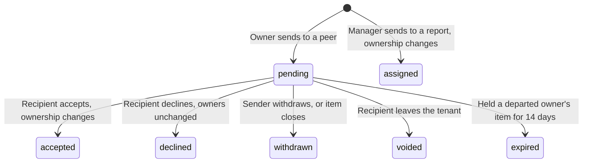
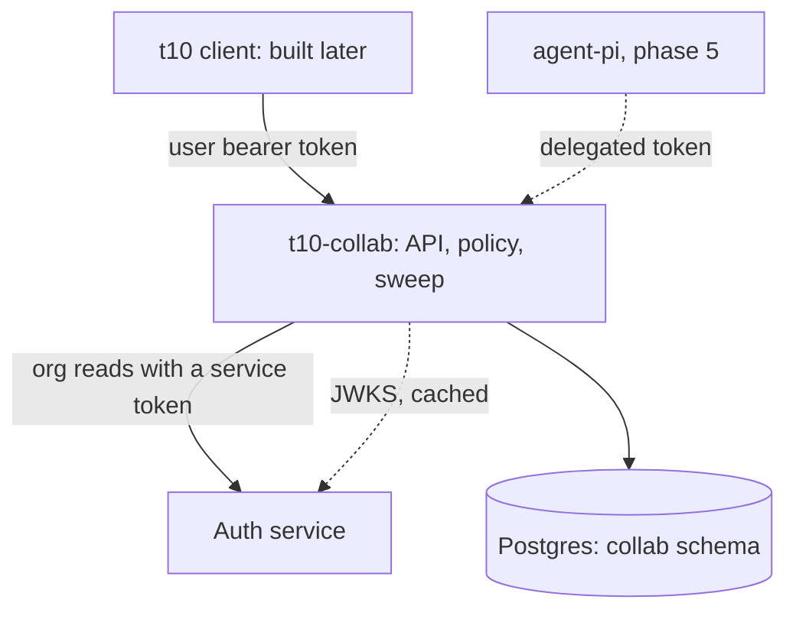

# Team Collaboration Design Doc

Oct 31, 2026 · @Felix Liang

Status: rollout steps 1 to 4 are built. The README lists where the build differs from this design.

## Summary

Build `t10-collab`, a new business module where people in a tenant send work to each other and manage it together. It is a small Go service with its own Postgres database, and it trusts the auth service for identity and org facts only.

Five decisions keep it small:

1. **People's work only.** This module has no link to `agent-pi` tasks: no shared table, ID, queue or tool name. See "Not the agent task".
2. **Sending is an offer, unless a manager sends it.** Between peers, ownership changes only when the recipient accepts, so a declined item stays with its sender. A manager's send to someone beneath them is an assignment, which changes ownership at once.
3. **Many owners, many collaborators.** An item can have several people responsible for it, and others can work on it with them. Nobody becomes an owner without accepting, unless their manager assigns it.
4. **Shared lists are how a group works together.** A list has its own members, because an org unit can't model a cross-team group. A list can link to an org unit to fill those members, but access always comes from the list.
5. **One policy package.** Every route and any later agent tool uses the same access check, applied in the SQL query before pagination.

Two gaps must close first. The auth service gives a module no way to list a tenant's members, and self-registered users have no display name. Without both, nobody can pick a teammate to send to.

V1 is an API with no client. The client is a later project, so no one can use the module until it ships.

This is the first business module. It meets the contract in `../../ARCHITECTURE.md`, which adds a manifest, a `target` reference on notifications and attention counts for `t10-notify`. The daily digest lives in `t10-notify`, not here.

## Terms

Users see the word "task". Code, schema, API routes and tool names say **work item**, so that a search for `task` in t10 only ever finds agent work.

| Term | Meaning |
| --- | --- |
| Work item | One piece of work for people to do. Shown to users as a task |
| Owner | A person responsible for an item. An item can have several, all with the same rights |
| Collaborator | Someone else working on or following an item |
| Offer | A request for someone to take over or share ownership of an item |
| Assignment | A manager's send to someone beneath them, which needs no acceptance |
| Inbox | The offers waiting for a user's answer |
| Shared list | A named group of items and the members who manage them |
| Team-linked list | A shared list that takes members from an org unit, as well as any added by hand |

## Not the agent task

`agent-pi` already has tasks: a background task is a sub-agent session in a conversation. The two share a name and nothing else.

| | Agent task (`agent-pi`) | Work item (`t10-collab`) |
| --- | --- | --- |
| Who does the work | A sub-agent | A person |
| Lifetime | Ends with its conversation | Lasts until people finish it, often days or weeks |
| Stored in | `app.tasks`, a conversation document | Postgres tables in `collab` |
| Visible to | The parent conversation | The people named on the item, and its list's members |
| Identifier | `t1`, unique per session | `wi_<hex>`, unique everywhere |
| Created by | The model, through `agent_<name>` | A person, through the API |
| Tools | `task_send`, `task_list`, `task_stop`, `task_note` | `work_*`, in phase 5 only |

**Rules that keep them apart**

- `t10-collab` never calls `agent-pi`, and `agent-pi` never reads this database.
- Nothing here stores a task ID, session ID or conversation ID.
- If an assistant later acts on a work item, it's an ordinary API caller with a delegated token. Finishing an agent task never changes a work item by itself.

## Goals and non-goals

**Goals**

- Let a user send a work item to another member of their tenant, and let that person accept or decline it.
- Let a manager assign a work item to someone beneath them, with no acceptance step.
- Show each user what they've received, what they've sent and what they own.
- Let several people manage items together, with shared status, comments and history.
- Keep every action attributable to a person, and to an agent if one acted for them.
- Keep tenants isolated by database constraints as well as code.

**Non-goals for v1**

- A user-facing client. It's built later, against this API.
- Sprints, boards, subtasks, dependencies, recurring items, labels and time tracking.
- File attachments. Documents owns files, and an item can link to one later.
- Chat. Comments belong to one item.
- Push notifications, email and SMS.
- Work shared across tenants.
- Agents reading or changing work items, until phase 5.

## User flows

**Send and receive**

1. Ada creates an item and owns it.
2. Ada sends it to Bob, with an optional note. Ada still owns it, and it appears in Bob's inbox.
3. Bob accepts and takes Ada's place as an owner. Ada stays on as a collaborator, so she can follow it. Any other owners are unchanged.
4. Or Bob declines, with an optional reason. Ada keeps the item and is told why.

Ada can withdraw the offer while it's pending. An item can have several pending offers, but only one to each person, and each sender can have only one pending transfer.

**Share ownership**

1. Ada owns an item and sends it to Bob with `mode=share`, rather than the default `mode=transfer`.
2. Bob accepts and becomes an owner. Ada stays an owner too.
3. Either of them can stop being an owner later, as long as someone else still owns the item. A list item can have no owners, so its last owner can leave too.

**Assign, when the sender is a manager**

1. Carol manages Bob, directly or further up the org, and sends him an item she owns.
2. Bob becomes an owner at once. There's no inbox step, and Bob can't decline.
3. Bob is notified and sees it among his owned items. With `mode=transfer`, Carol stays on as a collaborator. With `mode=share`, she stays an owner.

Bob can still hand the item on. A send from him is an ordinary offer, even back to Carol, and he stays an owner until someone accepts.

The service decides which of these applies, not the client, so a caller can't choose to skip acceptance. Both use the same route.

**Manage together**

- Any owner can add collaborators, who can then edit the item and comment on it.
- A group creates a shared list. Every list member can see and edit all of its items.
- A list item can have no owner, and any list member can claim it. That gives a team a shared backlog.
- A list owner can link the list to an org unit, so the team's members join it without being added one at a time. People from other teams can still be added by hand.
- Every change appears in the item's history, and the people on the item are notified in the app.

**Item status**

Status is `todo`, `doing`, `done` or `cancelled`. Anyone who can edit an item can move it between `todo`, `doing` and `done`, including reopening it. Only the creator or an owner can cancel, and one owner doesn't need the others to agree. Closing an item withdraws any pending offer, and a closed item can't be sent.

## Proposed architecture

The service follows the auth design's rules for a business module: it verifies tokens offline, owns record-level access and reads org facts with a service token.

| Concern | Decision |
| --- | --- |
| Repo | New sibling repo, `t10/t10-collab`, an independent Go module |
| Runtime | One static Go binary, two stateless replicas on Kubernetes, one on Compose |
| Port | `8082`, which no t10 Compose file uses today |
| Database | Its own Postgres database and `collab` schema, because the auth design keeps auth's database separate from business data |
| Migrations | Embedded, run at startup under an advisory lock, as in `auth-server` |
| Telemetry | OpenTelemetry, to the collector the sibling repos use |
| Messaging | None. No Redis or broker |

Go, pgx and the standard router match `auth-server`, so one engineer can run both the same way.

### Packages

| Package | Owns |
| --- | --- |
| `workitems` | Items, status, owners, collaborators, comments |
| `offers` | Sending, accepting, declining, withdrawing |
| `lists` | Shared lists, their members and their unit links |
| `policy` | Every access rule, tenant settings, and the SQL filter for "items this user can see" |
| `activity` | Item history and in-app notifications |
| `people` | Cached org reads from the auth service |
| `sweep` | The 15-minute job: departures and team-linked list members |
| `server` | HTTP routes, with the required action declared on each one |

### Who the caller is

Every request goes through the shared verifier. The tenant always comes from the token's `tid`, never from a request value.

| Token | Result |
| --- | --- |
| A person's | Allowed, then checked by `policy` |
| A delegated agent's | Refused until phase 5. After that, also needs `work:*` actions on every grant |
| A service's own | Refused on user routes |
| No `tid` | Refused. Platform admins' tokens have none, and platform admins get no path into business records |

**Checking membership.** The caller's own membership is trusted from the token. Minting rechecks it, so a removed user loses access within 5 minutes, the same limit the auth design accepts for every service. An action that names another person, such as sending or adding a collaborator, checks that person with the auth service and fails closed.

The result is that people can keep reading and editing through a short auth outage, while sending stops. It's the right way round: a missed send can be retried, but a send to the wrong person can't be undone.

## Access rules

These rules live only in `policy`. List queries apply them in SQL before pagination and counts, as the init requirements demand.

| Action | Allowed for |
| --- | --- |
| Read, comment | Creator, owners, collaborators, the recipient of a pending offer, members of the item's list |
| Read only | Any owner's manager, if the tenant's manager visibility allows it |
| Edit fields, change status | Creator, owners, collaborators, members of the item's list |
| Send | Any owner. For an unowned list item, any list member |
| Accept, decline | The offer's recipient |
| Withdraw | The offer's sender, or any owner |
| Stop being an owner | That owner, if another owner remains or the item is on a list. Their pending offers are withdrawn |
| Claim | Any member of the item's list, if it has no owners |
| Add or remove collaborators | Creator, any owner |
| Cancel | Creator, any owner |
| Delete | Any owner. The creator too, if a list item has no owners. A soft delete, hidden from everyone |
| Manage list members, rename, archive, link a unit | List owner |
| Reassign an item, or give a list an owner | Module admin, only for what is in the departure queue |
| Change tenant settings | Module admin |

- **Declining ends access.** A recipient who isn't otherwise on the item can't see it after declining.
- **One owner can't remove another.** Owners can only remove themselves. Adding an owner always goes through a send, so nobody becomes an owner without accepting or being assigned. A send to someone who's already an owner returns `409 already_owner`.
- **Only the reporting line skips acceptance.** A send is an assignment when the recipient is anywhere beneath the sender in the org. Everyone else's send is an offer, including a send up the org and a tenant admin's. No tenant setting changes this.
- **The reporting line is checked fresh.** Each send reads `/v1/org/members/{user}/reports?transitive=true` for the sender, bypassing the 60-second cache, so someone who was just moved can't be assigned work by their old manager. Each send also reads the sender's and recipient's member records, so a removed or suspended manager can't assign work. If any read fails, the send fails.
- **Units never decide the reporting line.** The manager chain and `org_units` are separate in the auth service. Only the manager chain makes a send an assignment or allows manager visibility.
- **Tenant admins are the module admins in v1.** This module shows them only the departure queue, with item titles and owners, and the tenant settings. They can still reach more through the org, because they control it: an admin can make themself someone's manager, and they set `manager_visibility`, so they can read what people own and assign to anyone. That's accepted, and such org changes are recorded only in auth's audit log. The role is read from the auth service on each admin request, and fails closed.
- **Platform admins have no access.** This follows the init requirements.
- **Export doesn't exist in v1,** so no permission is needed yet.

### Manager visibility

Each tenant chooses whether managers can read their reports' items. A module admin sets this through `manager_visibility`, and it's off until they do.

| Value | A manager can read items owned by |
| --- | --- |
| `none`, the default | Nobody, through being a manager |
| `direct_reports` | Their direct reports |
| `all_reports` | Everyone beneath them in the org |

- **Read only.** Manager visibility never allows editing, commenting, sending or cancelling. A manager who needs to do those has to be added as a collaborator.
- **Owned items only.** Pending offers, and items a report merely created or collaborates on, stay out, so a declined item is never exposed.
- **Applied at request time.** The setting and the reports are read per request, with org reads cached for at most 60 seconds, so a change needs no new sign-in. Reports filter in SQL on `work_item_owners.user_id = ANY(...)`, before pagination. An item shows up if any of its owners is a report.
- **Used only when needed.** The org read happens for `view=reports`, or for a single-item read that would otherwise return `404`. Ordinary views make no extra call, so they keep working through an auth outage.
- **Fails closed.** If reports can't be read, the manager gets no access through this rule. Their other access is unaffected.
- **Changes are visible.** Every member can read the current value, so people know who can see their work. Each change writes an event naming the admin.
- **It covers existing items.** Turning it on immediately exposes items people created while it was off, so a client must warn the admin and tell members.
- **Suspended reports drop out.** `/v1/org/members/{user}/reports` leaves out suspended accounts, so a manager can't read their items until the suspension ends.

## Data model

Foreign keys that include `tenant_id` make cross-tenant links impossible, as in `auth.org_units`. `user_id` columns are plain text with no foreign key, because users live in another database. All IDs use the `prefix_<hex>` format.

| Table | Key columns | Notes |
| --- | --- | --- |
| `work_items` | `tenant_id`, `id`, `list_id`, `title`, `description`, `status`, `priority`, `due_at`, `creator_id`, `version`, `client_ref`, `deleted_at`, `queued_at`, `queue_reason` | The queue columns are set only while an item waits for a module admin |
| `work_item_owners` | `tenant_id`, `item_id`, `user_id`, `added_by` | Primary key is `tenant_id + item_id + user_id`. An item with no `list_id` always has at least one row, which `workitems` enforces |
| `work_item_collaborators` | `tenant_id`, `item_id`, `user_id`, `added_by` | |
| `offers` | `tenant_id`, `id`, `item_id`, `from_user_id`, `to_user_id`, `mode`, `note`, `state`, `response_note`, `responded_at`, `expires_at` | `expires_at` is set only on an offer holding a departed owner's item. Mode is `transfer` or `share`. Partial unique indexes allow one `pending` offer per item and recipient, and one `pending` transfer per item and sender. An assignment is a row that starts as `assigned`, so one history covers every send |
| `lists` | `tenant_id`, `id`, `name`, `org_unit_id`, `archived_at`, `queued_at`, `queue_reason` | `org_unit_id` is an optional link to an auth unit. It's plain text with no foreign key, because units live in another database |
| `list_members` | `tenant_id`, `list_id`, `user_id`, `role`, `source` | Role is `owner` or `member`. Source is `manual`, or `org` for a member the unit link added |
| `comments` | `tenant_id`, `id`, `item_id`, `author_id`, `body`, `deleted_at` | Plain text, up to 10,000 characters |
| `events` | `tenant_id`, `id`, `item_id`, `actor_user_id`, `actor_grant_id`, `kind`, `detail`, `at` | Append-only. Item history and audit trail. `actor_grant_id` is set when an agent acted. `item_id` is null for a settings or unit link change |
| `tenant_settings` | `tenant_id`, `manager_visibility`, `updated_by`, `updated_at` | No row means `none` |
| `notifications` | `tenant_id`, `id`, `user_id`, `event_id`, `read_at` | One row per person to tell |

**Writes.** A change, its event and its notifications commit in one transaction, so history can't disagree with the data.

**Two people editing.** Each item has a `version`. A write must send the version it read, and a stale write gets `409 version_conflict`, so a client can reload rather than silently overwrite someone else's change.

**Racing on an offer.** Accepting runs `UPDATE ... WHERE state = 'pending'`, so accepting and withdrawing at the same moment can't both win.

**Racing on ownership.** Every change to an item's owners first locks its `work_items` row. Two owners leaving at once can't leave an item with nobody, and two people claiming at once can't both win.

**Flaky networks.** A client may send a `client_ref` when creating an item. It's unique per creator, so a retry returns the first item instead of a duplicate.

## API

All routes need a bearer token, and every list route is paginated. `docs/openapi.yaml` will hold the full spec once the design is agreed.

| Route | Purpose |
| --- | --- |
| `POST /v1/work-items` | Create an item, optionally sending it at once |
| `GET /v1/work-items` | Filter by `view=owned`, `sent`, `collaborating`, `list` or `reports`, and by status |
| `GET /v1/work-items/{id}` | Read one item |
| `PATCH /v1/work-items/{id}` | Edit fields or status. Needs `version` |
| `DELETE /v1/work-items/{id}` | Soft delete |
| `GET /v1/work-items/{id}/events` | Item history |
| `POST /v1/work-items/{id}/claim` | Claim an unowned list item |
| `DELETE /v1/work-items/{id}/owners/me` | Stop being an owner |
| `PUT`, `DELETE /v1/work-items/{id}/collaborators/{user}` | Add or remove a collaborator |
| `GET`, `POST /v1/work-items/{id}/comments` | Read or add comments |
| `POST /v1/work-items/{id}/send` | Send. `mode` is `transfer`, the default, or `share`. The result's `state` is `pending` for an offer or `assigned` for an assignment |
| `GET /v1/offers` | `box=inbox` for pending offers, or `box=sent` for everything sent, including assignments |
| `POST /v1/offers/{id}/accept`, `/decline`, `/withdraw` | Answer or cancel an offer |
| `GET`, `POST /v1/lists`, `PATCH /v1/lists/{id}` | Manage lists. `PATCH` also sets or clears `org_unit_id` |
| `PUT`, `DELETE /v1/lists/{id}/members/{user}` | Manage list members. Removing an `org` member returns `409 managed_by_unit` |
| `GET /v1/people?q=&unit=` | Find a teammate to send to, optionally within an org unit |
| `GET /v1/units` | Read the tenant's org units, to browse people or link a list |
| `GET /v1/notifications?after=` | New notifications since a cursor |
| `POST /v1/notifications/read` | Mark notifications as read |
| `GET /v1/settings` | Read tenant settings, for any member |
| `PUT /v1/admin/settings` | Module admin: change tenant settings |
| `GET /v1/admin/departures` | Module admin: items waiting for a new owner |
| `POST /v1/admin/departures/{item}/reassign` | Module admin: give a queued item a new owner |
| `GET /v1/admin/departures/lists` | Module admin: lists nobody can manage |
| `POST /v1/admin/departures/lists/{id}/owner` | Module admin: give a queued list a new owner |

A missing item and a forbidden item both return `404`, so IDs can't be probed.

**Staying up to date.** Clients poll `/v1/notifications` about every 30 seconds while open. Polling needs no broker. A streaming connection would also outlive the 5-minute token and need a fan-out across replicas. SSE can be added later without changing the data.

## When someone leaves

The auth service publishes no change events, so this module has to find out for itself. A job runs every 15 minutes under a Postgres advisory lock, so only one replica runs it. It reads every member of each tenant it holds work for, including inactive and suspended ones, and then decides everything from Postgres, so no row stays locked while it waits on the network.

Nothing records who has been handled. Each pass works out what an item needs from its owners and offers as they stand, so a retry, or someone reinstated who leaves again, needs nothing special.

| Event | Result |
| --- | --- |
| Membership `inactive` | Pending offers to them are voided and the sender is told. Offers from them stay, so the recipient can still accept. They come off every list. Their items move as below |
| Account suspended | New offers to them are refused. Their items and list places stay, because a suspension may be temporary. An item whose owners are all suspended joins the queue, and leaves it by itself if one returns |
| Member missing from a read | Nothing. Only an explicit `inactive` counts as leaving |
| Org read fails | The job leaves that tenant alone and retries. A failed read never counts as someone leaving |

A departed owner comes off each open item if another owner remains, including a suspended one, or if it's on a list. A list item left with no owners can be claimed by its members.

An item off a list keeps its last owner until someone takes it on, so it's never ownerless. It moves to the first of these that applies:

1. **A live offer is left in place.** Its 14-day clock starts when the sweep first finds it holding the item, so an old offer still gets the full time. If it's declined, withdrawn, voided or expires, the next pass moves on.
2. **The creator** is offered it, if they're still active.
3. **The manager** of each departed owner is offered it, in turn, if they're active.
4. **The module admin's departure queue** takes it.

These offers come from `system:sweep`, and each is a `share` with a 14-day expiry. Whoever accepts becomes an owner, and the next pass removes the departed owner. An offer that expires or is voided moves on to the next person. A decline is a real answer, so the item goes to the queue without asking anyone else.

Closed items are left as they are, because nothing needs doing on them. If someone reopens one, the next pass picks it up.

**The queue.** An admin sees titles and owners, and a reassign needs no acceptance, because nobody else can act on the item. It replaces every owner, and a suspended owner stays on as a collaborator. Both admin actions reach only what's queued, and anything else returns `404`. Lists join the queue when no active owner remains, or when no active member remains and they still have open items. A new list owner can then manage the rest.

## Team-linked lists

A shared list can link to one org unit, so the list keeps up with the team. The link only fills `list_members`. Every access check still reads that table, so a linked list follows the same rules as any other.

- **Any unit can be linked.** `kind` is a label an admin can change, so it decides nothing here. Only the unit's direct members join, not those of units beneath it.
- **Linking takes effect at once.** Setting `org_unit_id` reads the unit's members for the token's `tid` and adds them, so the list doesn't wait for the sweep. If the read fails, or the unit isn't in the tenant, the request fails.
- **The sweep keeps it current.** The same 15-minute job reads `/v1/org/units/{id}/members` for each linked list, and adds or removes only `org` members.
- **Hand-added members stay.** The sweep never changes a `manual` member, and every list owner is `manual`. Using `PUT` on an `org` member makes them `manual`, so they stay after leaving the unit. Removing an `org` member by hand is refused, because the next sweep would add them back.
- **Requests don't read the org.** List access never calls the auth service, so lists keep working through an auth outage.
- **Leaving a unit isn't instant.** Someone who leaves can keep list access for up to 15 minutes. A list that must cut access at once should stay unlinked.
- **Items don't move.** Someone removed from a list keeps any item they own or collaborate on.
- **Link changes are recorded.** Each one writes an event naming the list owner, or the sweep if it removed the link.

| Unit read | Result |
| --- | --- |
| Returns members | `org` members are added or removed to match |
| Returns `[]` | The unit is really empty, so its `org` members are removed |
| Returns `404` | The unit was deleted. The link is cleared, the list's owners are told, and its `org` members become `manual` |
| Fails | The job changes nothing and retries. A failed read never removes anyone |

Clearing a link by hand also makes `org` members `manual`, so nobody loses access by surprise.

## Security considerations

- **Tenant isolation:** `tid` comes from the verified token, and composite foreign keys back it up in the database.
- **Spam:** anyone in a tenant can fill a colleague's inbox, so sending is rate limited per user. Blocking is left out, because a tenant is a closed, invitation-only group.
- **Untrusted text:** titles, descriptions, comments and notes come from other people. Clients must render them as plain text, not HTML.
- **Prompt injection, phase 5:** a colleague's task description would reach the reader's assistant. It must arrive marked as data, the way `agent-pi` wraps `<task_report>`, or anyone could steer someone else's agent through a task.
- **Sensitive content:** tokens are never logged, and neither are item text or comments.
- **Secrets:** the service needs only its own client secret, from the secret store.

## Changes needed in other repos

These are the auth service gaps, all checked against the code.

| Gap | What exists today | Change |
| --- | --- | --- |
| No member list for services | `GET /v1/tenants/{id}/members` is for tenant admins only. Org routes reach members only through a unit or a manager, so a member in neither can't be found | Add `GET /v1/org/members?tenant=<id>`, paged, returning each member's org fields plus `display_name` |
| No name on org reads | `GET /v1/org/members/{id}` returns IDs and status only | Add `display_name` to that response |
| Display names are empty | `users.display_name` defaults to `''`, and neither registration nor the account pages set it | Ask for a name at registration, and let users edit it |
| Verifier can't be imported | `auth-server` has no git remote and its module path is `t10-auth-server`, so a sibling module can't fetch it | Copy `verifier/` into `t10-collab` and add it to the workspace parity check, as with `roomprotocol`. It has one dependency. Move to a real import once `auth-server` has a remote |
| Manager links go stale | When a manager leaves, a report's `manager_user_id` still names them, and direct reports reads stop finding that report | Return the nearest active manager, and keep the raw link so reinstating someone still works |
| Admin form cuts the tree | The manager dropdown shows a departed manager as "None", so saving a unit change erases the link | Keep the current manager in the form, and let `SetPlacement` accept an unchanged manager |
| Service not registered | `deploy/setup.sh` creates two service accounts | Add `t10-collab`, and label its pods `t10.dev/auth-client` for the network policy |

Sign-in names must stay out of the new route. They're unverified and can hold someone's phone number, so teammates should see display names only.

Phase 5 also adds `t10-collab` to the `runtimes` audiences in `clients.yaml`, and an MCP server entry in `agent-pi`.

## Alternatives considered

| Option | Why not |
| --- | --- |
| Build it inside `auth-server` | The auth design makes record-level access a non-goal, and identity shouldn't carry business data |
| Extend `agent-pi` tasks | The exact confusion to avoid. Agent tasks live and die with a conversation |
| Assign directly for every sender, with no offer | Simpler, but anyone could put work on a colleague who never saw it. Only a manager has that authority, so only a manager's send skips the offer |
| Let the client choose offer or assignment | A caller could skip acceptance by asking to. The service works it out from the org instead |
| Use `team` org units as the sharing boundary | A membership has a single `org_unit_id`, so a person can't be in two groups, and only tenant admins can change it. Lists let people form their own groups, and a list can link to a unit to fill its members |
| Let a person join several units in `auth-server` | It would change the placement code, every org read and the public `org_unit_id` field, and groups would still need a tenant admin |
| Check unit membership on each list request | Leaving a team would take effect at once, but every list view would then depend on auth being up |
| Keep one owner per item | Clear about who's responsible, but people sharing the work would have to pick one name. Owners share the same rights, so an item has no primary owner |
| Let an owner add another owner directly | Simpler, but it would put work on a colleague who never agreed. Sharing ownership uses the same offer rules as any send |
| Adopt an existing tracker, such as Jira or Linear | Fast to start, but it adds a separate identity system and tenant model, and may be hard to use in China. Based on general knowledge, not checked |
| Check every request with the auth service | Instant revocation, but every read then depends on auth being up |

## Open questions

- [x] **Must a recipient accept?** Yes, unless the sender is their manager at any level. A manager's send moves ownership at once. There's no tenant setting for this.
- [x] **Which client ships first?** Decided later. V1 is an API only, and the client is its own project. A web client would need the OAuth entry the auth design reserves for a future web backend.
- [x] **How do people hear about an item when the app is closed?** They don't, in v1: it appears the next time they open the app. Push and email are out. Notifications are stored apart from how they're delivered, so a channel can be added later without changing the data.
- [x] **Can anyone send to anyone in the tenant?** Yes, since a tenant is an invited group.
- [x] **Should managers see their reports' items?** Each tenant decides. See "Manager visibility".
- [ ] **Can one send go to several people?** V1 has one recipient. An item can already have several pending `share` offers, so a later version could send one to each person on a single item, with no copies.
- [ ] **How long are closed items, soft deletes and history kept?** This depends on customer contracts, like the auth audit log.
- [ ] **How much should an assistant be able to do?** See phase 5. The recommendation is that an agent can read and draft, and only a person can send or accept.

## Rollout

1. **Auth prerequisites.** Add the member list and display names, fix the manager links and admin form, register the service, and copy the verifier.
2. **Core.** Items, offers, comments, history, notifications and the API, with tests that prove filtering runs before pagination and that tenants can't cross. A `cmd/testclient` drives the API against Compose, using the auth service's dev password grant, because no client exists.
3. **Working together.** Collaborators, shared lists and claiming.
4. **Departures and settings.** Add the sweep, the admin queue, manager visibility and team-linked lists, which depend on the sweep. Departures come before real users, because without them a person's leaving strands their work.
5. **Agents, optional.** Add `work:read`, `work:write`, and separate `work:delete` and `work:send` actions, and an MCP server whose tools are named `work_*`. Tools go through `policy` like every other route. `work:send` and `work:delete` stay out of default grants, and text from other people arrives marked as data.

The client is built separately, with no date yet, and needs steps 1 to 4. Step 5 doesn't depend on it.
